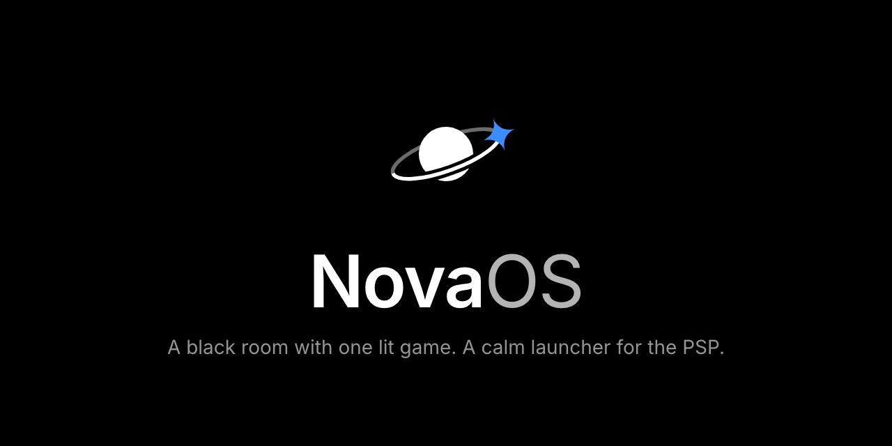
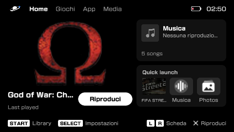
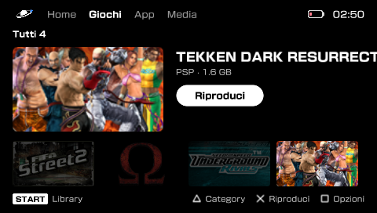
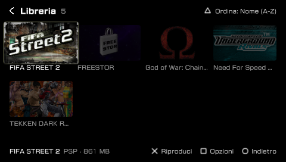
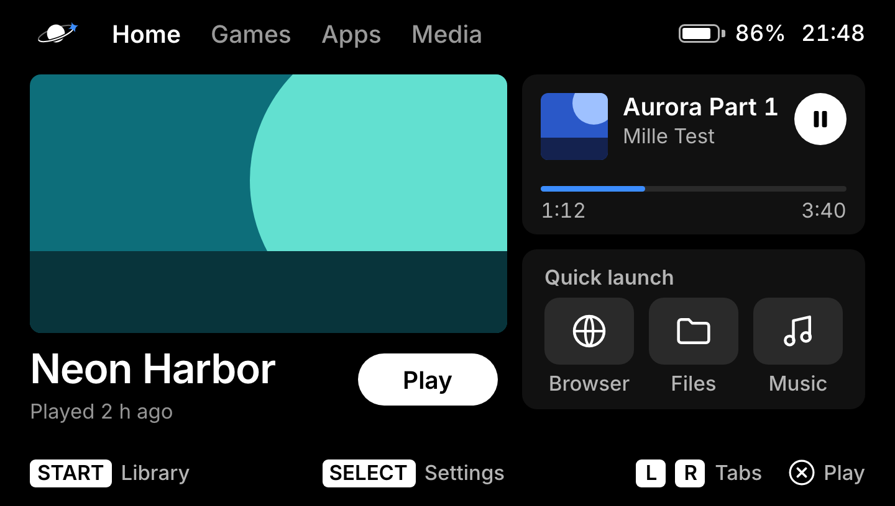
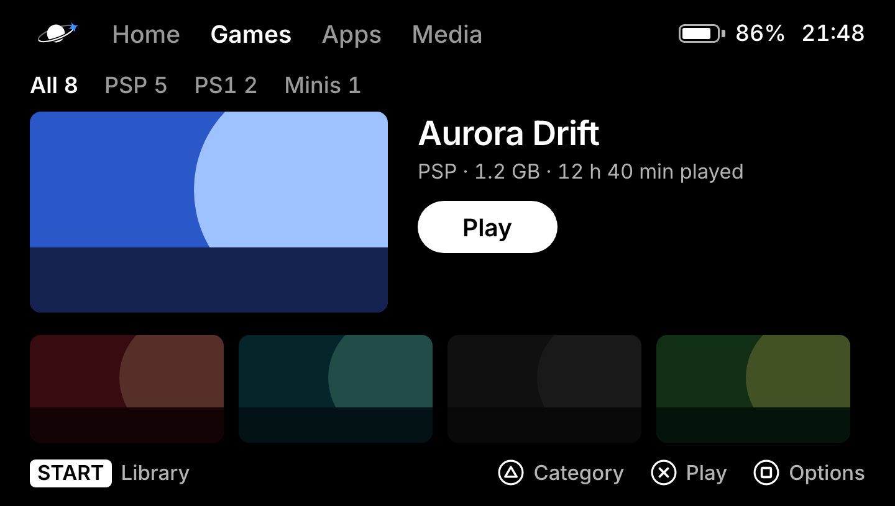
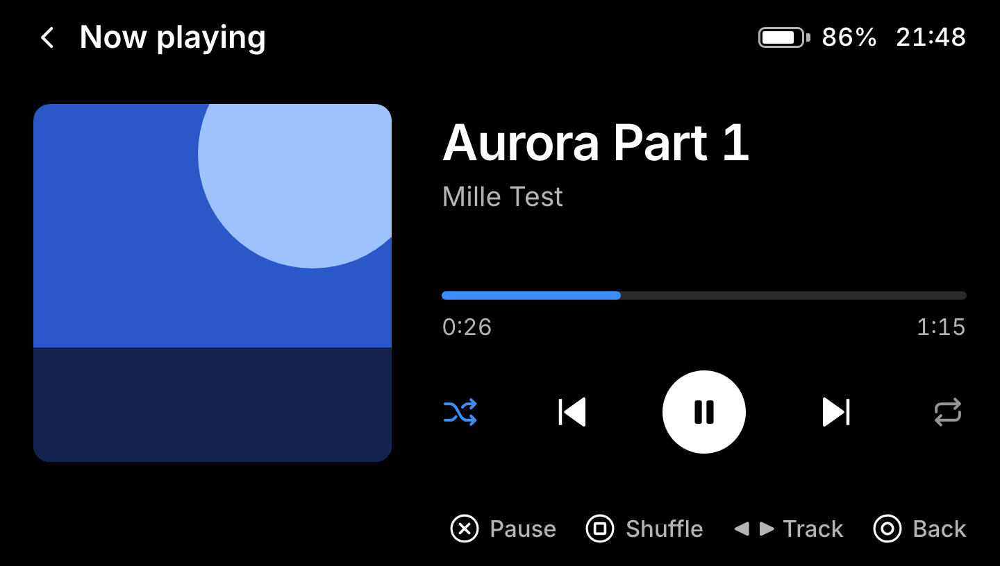
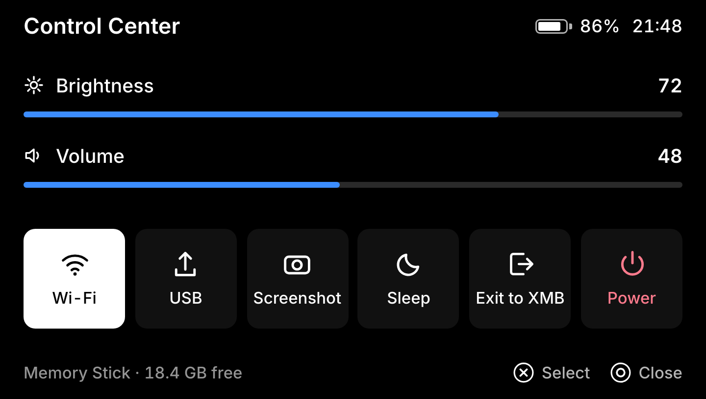
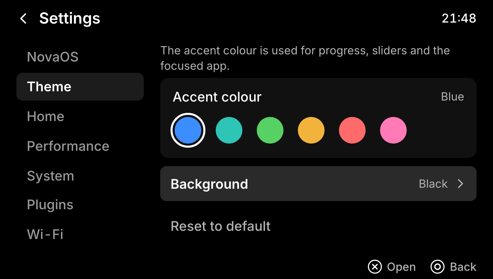
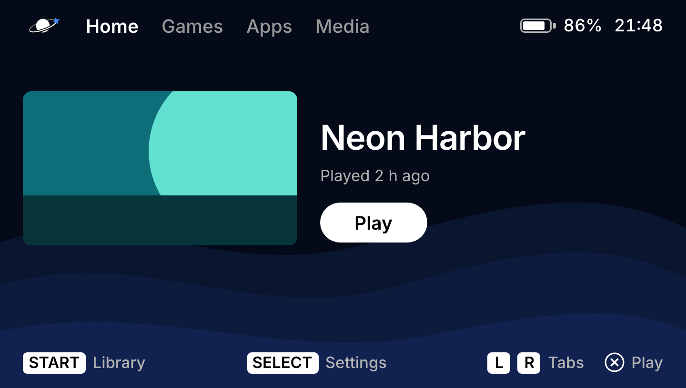

# NovaOS

A calm, modern launcher for the PSP that replaces the XMB. Black room, one lit game. Runs on custom firmware **ARK-4** and **ARK-5**.

  
  
  

Home, Games and Library, captured on a real PSP-3004.

## Screenshots

These are the design frames the interface is built to match, drawn at the PSP's native 480×272 and shown here at 3×.

| | |
|---|---|
|  **Home**: your last played game, music and quick launch |  **Games**: the lit game against its dimmed neighbours |
|  **Now playing** |  **Control Center**: brightness, volume, Wi-Fi, USB, Exit to XMB |
|  **Settings → Theme**: six accent colours |  **Backgrounds**: black by default, with built-in options and your own wallpaper |

## Requirements

- A PSP with ARK-4 or ARK-5 custom firmware installed.
- A Memory Stick (`ms0:`), or the internal storage on a PSP Go (`ef0:`).

## Install

1. Download the zip for your firmware from [Releases](../../releases/latest):
   - `NovaOS-<version>-ark4.zip` for ARK-4
   - `NovaOS-<version>-ark5.zip` for ARK-5 (it does not load on ARK-4)
2. Unzip it onto the root of your Memory Stick. You get `PSP/GAME/NovaOS/EBOOT.PBP`.
3. On the PSP, open **Game → Memory Stick** in the XMB and start **NovaOS**.

NovaOS keeps its own files (settings, cache) in a `NovaOS` folder on the Memory Stick. It never writes to `flash0:` or `flash1:`.

## How to use it

| Button | What it does |
|---|---|
| D-pad | Move |
| ✕ | Play / open / select (the footer always names what ✕ does) |
| L / R | Switch tabs |
| START | Library (from Home) |
| SELECT | Settings |
| □ | Options for the focused game or app |
| PS / HOME | Control Center: brightness, volume, Wi-Fi, USB, Sleep, **Exit to XMB**, Power |

Settings has categories for NovaOS, Theme (accent colour and background), Wi-Fi, power and USB, and the ARK options.

## Make NovaOS your default launcher (start it instead of the XMB)

By default you start NovaOS by hand from the Game menu. You can make ARK start it every time the PSP boots.

1. **Start NovaOS once** from the Game menu, as above.
2. Back up ARK's own menu first. On the Memory Stick, open `PSP/SAVEDATA/ARK_01234/` and **copy `VBOOT.PBP` to `VBOOT_ARKMENU.PBP`** so you can always go back.
3. Copy `PSP/GAME/NovaOS/EBOOT.PBP` to `PSP/SAVEDATA/ARK_01234/VBOOT.PBP`, replacing the old file.
4. In NovaOS open **Settings → NovaOS** and turn on **Boot into NovaOS**. The row below, "NovaOS is ARK's launcher", should read **Yes** after the next start.
5. Restart the PSP. It now boots straight into NovaOS.

**Go back to the XMB**
- For one session: choose **Exit to XMB** in the Control Center. NovaOS starts again at the next boot.
- Hold **SELECT** while the PSP starts to skip NovaOS and go to the XMB.
- To turn it off for good: switch **Boot into NovaOS** off in Settings, or copy `VBOOT_ARKMENU.PBP` back over `VBOOT.PBP`.

## Notes

- The ARK-5 build does not load on ARK-4. Pick the one that matches your firmware.
- If something goes wrong at startup, hold **SELECT** to reach the XMB and use ARK's recovery menu.
- NovaOS is not affiliated with or endorsed by Sony.

## License

Free to use and redistribute unmodified. The source code is not published. See [`LICENSE`](LICENSE).
